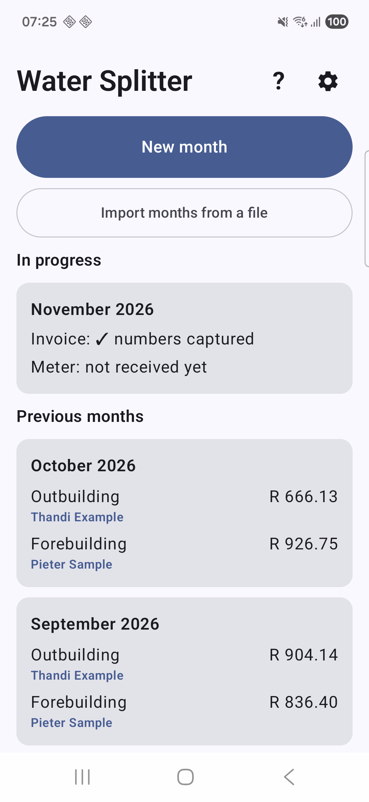
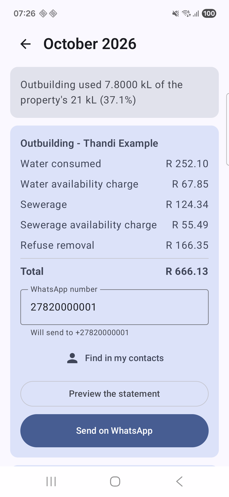
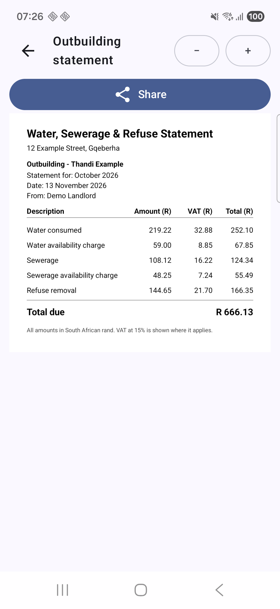
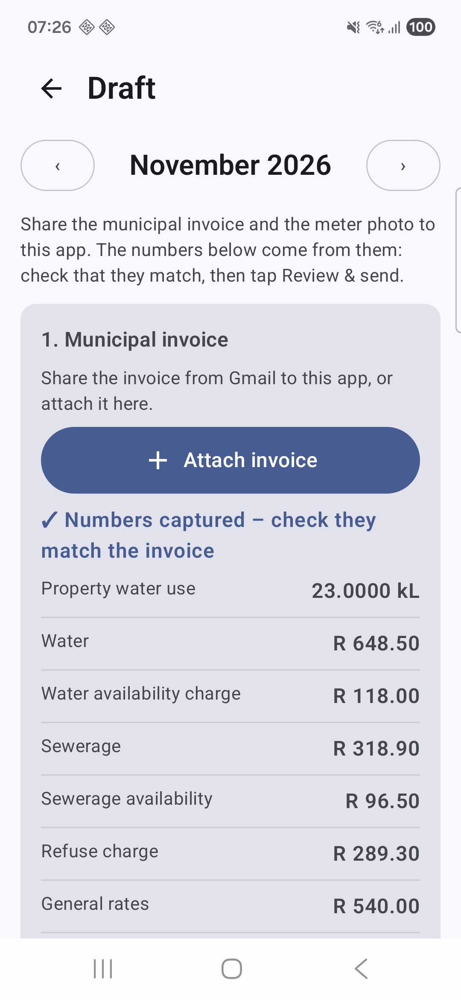

# Water Splitter

An Android app for a landlord who receives one municipal water, sewerage and refuse invoice for a property with two
houses. Water Splitter divides that invoice between the **outbuilding tenant**, the **forebuilding tenant** and the
**owner**, draws an itemised statement for each, and sends it on WhatsApp.

It is built for someone who is not technical: few buttons, plain words, and every number read from an invoice is
shown for the person to confirm before anything is sent.

<p>
  
  
  
</p>
<p>
  
  
  
</p>

All names, numbers and addresses in the screenshots are made up.

## What it does

- **A month at a time.** Share the municipal invoice (PDF) and a photo of the outbuilding water meter to the app, or pick
  them from the phone's Downloads, Documents, DCIM and Pictures folders. Several months can be in progress at once.
- **Reads the documents for you** (optional). With a Claude API key saved in the app, the invoice and meter photo are
  read automatically. The app only fills empty boxes, flags anything that does not add up (invoice lines versus total,
  wrong account number, wrong month, wrong meter, odd reading) and asks the person to confirm before it goes on.
  Without a key the numbers are typed in.
- **Fair splitting.** Water and sewerage follow the outbuilding meter; availability charges and refuse are shared
  half and half by days occupied; rates, interest and adjustments go to the owner unless assigned. VAT is recalculated
  per line and the three statements always add up exactly to the municipal total. See [docs/RULES.md](docs/RULES.md).
- **Statements on WhatsApp.** Each statement is drawn as an image so it shows inline in the chat. Tenants are
  remembered per house and per month, so old months keep the right name.
- **Months move between phones.** Long-press months to share, save or delete them. They travel as one `.wsmonths`
  file, which opens straight in the app on the other phone and asks, month by month, whether to skip or replace.
- **Backups.** A whole-app `.wsbackup` file, saved automatically after each month and restorable from Settings or by
  tapping the file anywhere on the phone.
- **Reminders** from a chosen day of the month, and **self-updates** from GitHub releases.

## Getting the app

Download the newest APK from the [Releases](https://github.com/ZainAjam/WaterSplitter/releases) page and open it on the
phone (Android asks once to allow installing from that source). Later versions are offered inside the app.

The repository is public, so it holds no rent history, account number, meter serial or address. Those are entered on the
phone or arrive through a backup.

## Project layout

| Folder | What is in it |
|---|---|
| `engine/` | Pure Kotlin/JVM calculation library (BigDecimal only), fully unit tested |
| `app/` | The Android app (Kotlin, Jetpack Compose); no database, one JSON file in private storage |
| `docs/` | [Business rules](docs/RULES.md) and [release process](docs/RELEASING.md) |

## Building

Needs JDK 17 and the Android SDK (compileSdk 37, minSdk 26).

```
./gradlew :engine:test :app:assembleDebug
```

Releases are built and signed by GitHub Actions when a `v*` tag is pushed (see [docs/RELEASING.md](docs/RELEASING.md)).
